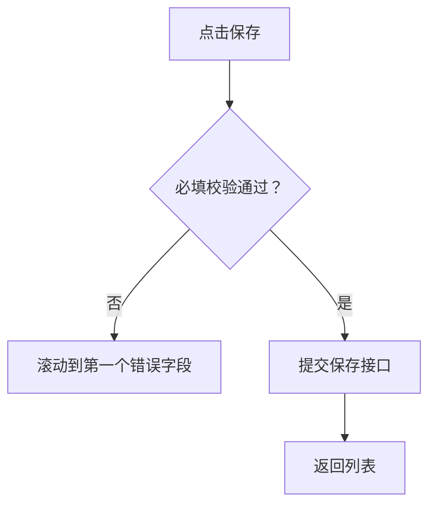

# 标注编写

## 源文档分离

以下文档须分开维护：

- 业务 PRD：业务需求的权威来源。
- 页面标注 Markdown：面向研发的页面说明，由 PRD 与界面推导而来。

除非用户明确要求，不要将生成的标注 id 写入业务 PRD。

## 迭代范围标注（非 CMS 全量资产）

规则见 SKILL.md §2.4，本节只保留编写提醒：每块须有可读 `来源` 行及 config 中匹配的 `sourceRefs`。

## 标注目录

目录选择与 `annotation.workspace.json` 输入规则见 SKILL.md §3.2；本节只保留多 PRD 示例路径与推荐目录结构。

示例：

```txt
docs/prd.md
docs/annotations/

requirements/module-management/prd.md
requirements/module-management/annotations/

prd/record-list.md
prd/annotations/record-list.md
```

将页面 Markdown、来源映射及可选 coverage 产出放在上述选定目录中。

推荐最小结构：

```txt
annotations/
  coverage.md
  pages/
    record-list.md
    record-create.md
```

## 抽取清单

阅读 PRD 时须抽取：

- 页面目的与业务对象。
- 用户角色与权限。
- 字段定义、必填性、可编辑条件、校验、默认值、唯一性、计算值，以及 PRD 约定的长度、范围、格式或精度。
- 状态、状态色、业务相关的禁用态与错误态。
- 点击行为、导航、弹窗/抽屉行为与确认行为。
- 表格列、排序、筛选、分页、批量操作与行操作。
- 跨页流程、保存/取消规则、脏表单提示与返回行为。
- 异常流程：请求失败、权限丢失、重复提交、数据缺失。
- 集成说明：API、幂等、导入/导出、审计日志与下游引用。
- 可见性：目标初始是否可见，或是否须在打开 modal、drawer、popover、手风琴、页签面板或路由后才出现。

## 页面层与状态层

规则见 SKILL.md §2.2–§2.3，本节不重复页面/状态路由与角标编号。

## 聚合规则

按研发会一并实现的范围聚合：

- 页面壳与页面级规则：仅当模式准入、保存/提交边界、脏表单处理或跨字段逻辑否则会散落子模块时，在页头或根容器挂一个角标。
- 筛选区：所有输入、重置、查询与默认行为共用一个角标。
- 表格：列、行操作、状态展示、排序及空态/错误态共用一个角标。
- 页签：所有页签切换及页签内加载规则共用一个角标。
- 表单区：每个连贯字段组一个角标；除非单字段规则复杂且独立，不按字段拆角标。
- 弹窗/抽屉：在弹窗标题或容器上挂一个角标。
- 仅按钮标注：仅当该按钮有独立流程、权限或副作用时允许。

子级逻辑已被父级标注块完全覆盖时，不要在父、子各挂重复角标。

## 字段优先内容写法

除非用户明确要求更细的实现规格，表单与查询类标注采用本写法。

### 字段组

用紧凑表格，只列 PRD 已确认且影响实现的列：

| 字段 | 必填/可编辑 | 核心约束 |
| --- | --- | --- |
| 数量 | 必填；审核后只读 | 正整数，按当前项目字段清单定义范围 |
| 单价 | 必填；审核后只读 | 大于等于0，按当前项目字段清单定义精度 |

- 仅当 PRD 定义了 `默认值` 时才写入。
- 仅当 PRD 定义了校验时机与错误文案，或它们会实质改变处理路径时，才写入。
- 不要把表格写成完整组件 API：占位、视觉、键盘、加载、可清空等常规行为除非影响业务结果，否则省略。
- 不要用通用前端经验填补缺失约束。仅当影响实现或验收时，将来源冲突或缺失规则标为补充 `A*`。

### 整页规则（page-global）

仅对存在跨字段处理的表单或流程增加一个 page-global 标注块。视情况保留四段短说明：

1. `页面模式`：新增/编辑准入、默认状态、字段锁定。
2. `提交边界`：保存草稿与提交的校验范围和阻断条件。
3. `结果处理`：成功后的停留页、跳转、刷新和反馈。
4. `离开处理`：未保存改动、取消或返回的规则。

不要在每个字段组块中重复上述规则。普通只读页与简单列表不需要 page-global 角标。

### 组件行为

已确立的设计系统行为视为默认，不必赘述。仅当行为承载业务含义时才标注组件，例如状态门控操作、改变查询语义的日期范围、阻断状态迁移的确认、或业务特定的选择器数据源。

## Markdown 标注块结构

除非目标项目已有更强约定，采用下列结构：

```md
<!-- anno:start id=1 page=/records target=module-table -->
## 需求描述：【本模块列表与行操作】

> 来源：本模块PRD.md#查询规则、本模块Demo列表页.md#表格与行操作

### 业务定义
- ...

### 显示样式
- ...

### 交互规则
- ...

### 字段与状态
| 字段/状态 | 必填/可编辑 | 核心约束 |
| --- | --- | --- |
| ... | ... | ... |

### 权限与异常
- ...

### 研发备注
- ...
<!-- anno:end id=1 -->
```

在 `annotation.config.json` 中声明稳定的 sourceRequirements，并通过 `sourceRefs` 映射每条标注：

```json
{
  "sourceRequirements": [
    { "id": "REQ-MODULE-001", "source": "../business-prd.md#查询规则", "page": "/records" }
  ],
  "annotations": [
    { "id": "1", "sourceRefs": ["REQ-MODULE-001"] }
  ]
}
```

编译器在重复标注 id、缺失 Markdown 块、未知来源引用或未映射的声明需求时必须失败。仅当用户明确接受不完整覆盖时，才使用 `--allow-unmapped`。

保留影响实现的 PRD 细节，不要压缩成模糊概述。

## Mermaid 用法

仅在有助于研发理解时使用 Mermaid：

- 跨页流程：`flowchart`。
- 状态迁移：`stateDiagram-v2`。
- 角色/流程类逻辑：用带角色标签的简单流程图。
- 数据关系：仅当关系对实现重要时使用 `erDiagram`。

字段规则、校验、权限与异常文案优先用表格与列表。

示例：

````md

````

## 运行时渲染规则

标注 Markdown 是编写期的权威来源。将单模块 config 或多模块工作区编译为 `annotation.bundle.json`；只读运行时加载该 bundle，在弹层中渲染对应标注块。

`page` / `routeMatcher` / 角标 id 规则见 SKILL.md §2.2–§2.3；发版门禁见 §7.1。

配置映射：

```json
{
  "id": "1",
  "page": "/records",
  "moduleName": "本模块列表与行操作",
  "target": {
    "selector": "[data-anno='module-table']"
  },
  "markdownFile": "annotations/pages/record-list.md",
  "blockId": "1"
}
```

解析规则：

- 首选块分隔：`<!-- anno:start id=1 ... -->` 至 `<!-- anno:end id=1 -->`。
- 遗留回退：`<!-- anno:id=1 ... -->` 直至下一个 `anno:id` 或 `anno:start` 标记。
- `blockId` 默认等于标注 `id`。
- 一个 Markdown 文件可含多个标注块。
- 页面弹层须渲染抽取出的块，而非整文件。
- 修改 Markdown 后须重新编译 bundle 并刷新或重载页面才可见。

## 补充标注规则

补充标注是由 Markdown 或 Codex 创建的一等片段：

- 分配 id `A1`、`A2`、`A3`。
- 存放在同一套标注 Markdown 体系中。
- 在 HTML 注释中包含 target 选择器与 page 元数据。
- 与自动生成的标注一并导出。

## 历史快照（仅用户明确要求时）

规则见 SKILL.md §2.4（默认不建 changelog/versions）。用户明确要求审计或恢复点时，在 annotations 目录内维护，且不进入默认 runtime 输入。

**changelog.md**（摘录格式示例）：

```md
## 2026-07-05

- Added `A2`: clarified identifier uniqueness behavior on the create form.
- Updated `3`: added low-stock orange status rule.
- Removed `A1`: obsolete import button note after UI removal.
```

每条记录：日期、标注 id、变更类型（Added/Updated/Removed/Moved/Split/Merged）、简短原因或 PRD 引用、受影响页面/模块。changelog 记标注变更，不记每条业务 PRD 编辑。

**富条目示例**：

```md
## 2026-07-05 15:30

| 类型 | 标注 | 页面/模块 | 变更说明 |
| --- | --- | --- | --- |
| Updated | `3` | 本模块列表与行操作 | 补充特殊状态和二次确认规则 |
| Added | `A2` | 编号字段 | 新增唯一性校验的补充标注 |
```

**versions/ 快照**：仅用户要恢复点或发布归档时使用。

```txt
annotations/
  versions/
    2026-07-05_1530/
      index.md
      pages/
        record-list.md
        record-create.md
```

快照只复制标注 Markdown 产出，不复制业务 PRD 或 runtime 文件。
