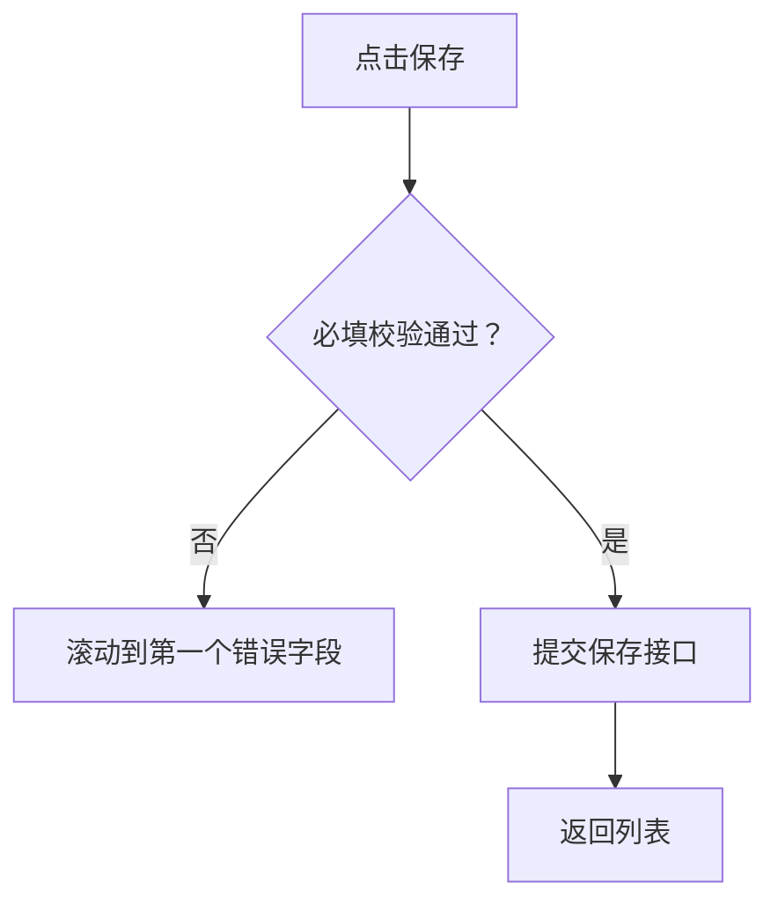

# Annotation Authoring

## Source Separation

Keep these documents separate:

- Business PRD: source-of-truth business requirements.
- Page annotation Markdown: developer-facing page instructions derived from PRD and UI.

Never write generated annotation ids into the business PRD unless the user explicitly asks.

## Iteration-Scoped Annotations (Not CMS Full Inventory)

规则见 SKILL.md §2.4，本节只保留编写提醒：每块须有可读 `来源` 行及 config 中匹配的 `sourceRefs`。

## Annotation Directory

目录选择与 `annotation.workspace.json` 输入规则见 SKILL.md §3.2；本节只保留多 PRD 示例路径与推荐目录结构。

Examples:

```txt
docs/prd.md
docs/annotations/

requirements/module-management/prd.md
requirements/module-management/annotations/

prd/record-list.md
prd/annotations/record-list.md
```

Use this selected directory for page Markdown, source mappings, and optional coverage output.

Recommended minimal structure:

```txt
annotations/
  coverage.md
  pages/
    record-list.md
    record-create.md
```

## Extraction Checklist

When reading PRDs, extract:

- Page purpose and business object.
- User roles and permissions.
- Field definitions, requiredness, editable conditions, validation, default values, uniqueness, computed values, and PRD-defined length, range, format, or precision.
- States, status colors, business-specific disabled states, and error states.
- Click behavior, navigation, modal/drawer behavior, and confirmation behavior.
- Table columns, sorting, filtering, pagination, batch actions, and row operations.
- Cross-page flow, save/cancel rules, dirty-form warnings, and return behavior.
- Exception flows: failed requests, permission loss, duplicate submissions, missing data.
- Integration notes: APIs, idempotency, import/export, audit logs, and downstream references.
- Visibility states: whether the target is initially visible or appears only after opening a modal, drawer, popover, accordion, tab panel, or route.

## Page Layer vs State Layer

规则见 SKILL.md §2.2–§2.3，本节不重复页面/状态路由与角标编号。

## Aggregation Rules

Aggregate by what a developer would implement together:

- Page shell and page-level rules: one badge on page header or root container only when mode entry, save or submit boundaries, dirty-form handling, or cross-field processing would otherwise be scattered across child modules.
- Filter area: one badge for all inputs, reset, query, and default behavior.
- Table: one badge for columns, row operations, status display, sorting, and empty/error states.
- Tabs: one badge for all tab switching and tab-specific loading rules.
- Form section: one badge per coherent field group, not per field unless a field has complex standalone rules.
- Modal/drawer: one badge on modal header or container.
- Button-only annotation: allowed only when the button has unique flow, permission, or side effects.

Avoid duplicate badges on a parent and child when the child logic is already fully covered by the parent annotation.

## Field-First Content Profile

Use this profile for form and query annotations unless the user explicitly asks for a more detailed implementation specification.

### Field groups

Use a compact table with only PRD-confirmed columns that matter to implementation:

| 字段 | 必填/可编辑 | 核心约束 |
| --- | --- | --- |
| 数量 | 必填；审核后只读 | 正整数，按当前项目字段清单定义范围 |
| 单价 | 必填；审核后只读 | 大于等于0，按当前项目字段清单定义精度 |

- Include `默认值` only when the PRD defines one.
- Include validation timing and error copy only when the PRD defines them or they materially change the handling path.
- Do not turn the table into a full component API: omit ordinary placeholder, visual style, keyboard, loading, and clearable behavior unless it changes business outcomes.
- Never fill a missing constraint from general frontend experience. Mark a source conflict or missing rule as supplemental `A*` only when it affects implementation or acceptance.

### Page-global rules

Add one page-global block only for forms or workflows with cross-field handling. Keep it to four short sections as applicable:

1. `页面模式`：新增/编辑准入、默认状态、字段锁定。
2. `提交边界`：保存草稿与提交的校验范围和阻断条件。
3. `结果处理`：成功后的停留页、跳转、刷新和反馈。
4. `离开处理`：未保存改动、取消或返回的规则。

Do not repeat these rules in every field-group block. Ordinary read-only pages and simple lists do not need a page-global badge.

### Component behavior

Treat established design-system behavior as implicit. Annotate a component only when its behavior carries business meaning, such as a status-gated action, a date range that changes query semantics, a confirmation that blocks a state transition, or a business-specific selector source.

## Markdown Block Shape

Use this structure unless the target project already has a stronger convention:

```md
<!-- anno:start id=1 page=/records target=module-table -->
## 需求描述：【本模块列表与行操作】

> 来源：本模块PRD.md#查询规则、本模块Demo列表页.md#表格与行操作

### 业务定义
- ...

### 显示样式
- ...

### 交互规则
- ...

### 字段与状态
| 字段/状态 | 必填/可编辑 | 核心约束 |
| --- | --- | --- |
| ... | ... | ... |

### 权限与异常
- ...

### 研发备注
- ...
<!-- anno:end id=1 -->
```

Declare stable source requirements in `annotation.config.json`, then map each annotation using `sourceRefs`:

```json
{
  "sourceRequirements": [
    { "id": "REQ-MODULE-001", "source": "../business-prd.md#查询规则", "page": "/records" }
  ],
  "annotations": [
    { "id": "1", "sourceRefs": ["REQ-MODULE-001"] }
  ]
}
```

The compiler must fail on duplicate annotation ids, missing Markdown blocks, unknown source references, and unmapped declared requirements. Use `--allow-unmapped` only when the user explicitly accepts incomplete coverage.

Keep PRD details that affect implementation. Do not compress them into vague prose.

## Mermaid Usage

Use Mermaid only when it improves developer understanding:

- Cross-page flows: `flowchart`.
- Status transitions: `stateDiagram-v2`.
- Role/process swimlane-like logic: use simple flowcharts with role labels.
- Data relationships: `erDiagram` only when the relationship is important for implementation.

Prefer tables and lists for field rules, validation, permissions, and exception messages.

Example:

````md

````

## Runtime Rendering Rules

Annotation Markdown is the authoring source of truth. Compile one module config or a multi-module workspace into `annotation.bundle.json`; the read-only runtime loads that bundle and renders the matching block in the popup.

`page` / `routeMatcher` / 角标 id 规则见 SKILL.md §2.2–§2.3；发版门禁见 §7.1。

Config mapping:

```json
{
  "id": "1",
  "page": "/records",
  "moduleName": "本模块列表与行操作",
  "target": {
    "selector": "[data-anno='module-table']"
  },
  "markdownFile": "annotations/pages/record-list.md",
  "blockId": "1"
}
```

Parsing rules:

- Preferred block delimiter: `<!-- anno:start id=1 ... -->` to `<!-- anno:end id=1 -->`.
- Legacy fallback: `<!-- anno:id=1 ... -->` until the next `anno:id` or `anno:start` marker.
- `blockId` defaults to the annotation `id`.
- One Markdown file may contain many annotation blocks.
- Page popup content must render the extracted block, not the whole file.
- Markdown changes become visible after recompiling the bundle and refreshing or reloading the page.

## Supplemental Annotation Rules

Supplemental annotations are first-class fragments created in Markdown or by Codex:

- Assign ids `A1`, `A2`, `A3`.
- Store them in the same annotation Markdown system.
- Include target selector and page metadata in the HTML comment.
- Export together with auto-generated annotations.

## 历史快照（仅用户明确要求时）

规则见 SKILL.md §2.4（默认不建 changelog/versions）。用户明确要求审计或恢复点时，在 annotations 目录内维护，且不进入默认 runtime 输入。

**changelog.md**（摘录格式示例）：

```md
## 2026-07-05

- Added `A2`: clarified identifier uniqueness behavior on the create form.
- Updated `3`: added low-stock orange status rule.
- Removed `A1`: obsolete import button note after UI removal.
```

每条记录：日期、标注 id、变更类型（Added/Updated/Removed/Moved/Split/Merged）、简短原因或 PRD 引用、受影响页面/模块。changelog 记标注变更，不记每条业务 PRD 编辑。

**富条目示例**：

```md
## 2026-07-05 15:30

| 类型 | 标注 | 页面/模块 | 变更说明 |
| --- | --- | --- | --- |
| Updated | `3` | 本模块列表与行操作 | 补充特殊状态和二次确认规则 |
| Added | `A2` | 编号字段 | 新增唯一性校验的补充标注 |
```

**versions/ 快照**：仅用户要恢复点或发布归档时使用。

```txt
annotations/
  versions/
    2026-07-05_1530/
      index.md
      pages/
        record-list.md
        record-create.md
```

快照只复制标注 Markdown 产出，不复制业务 PRD 或 runtime 文件。
